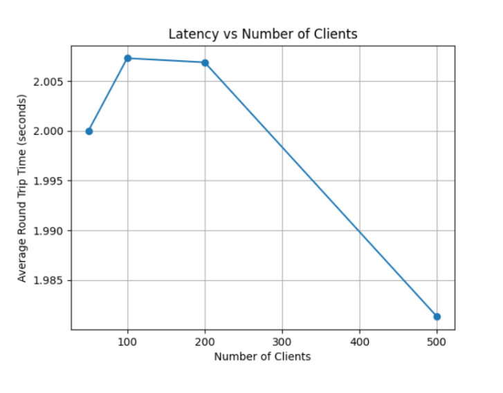
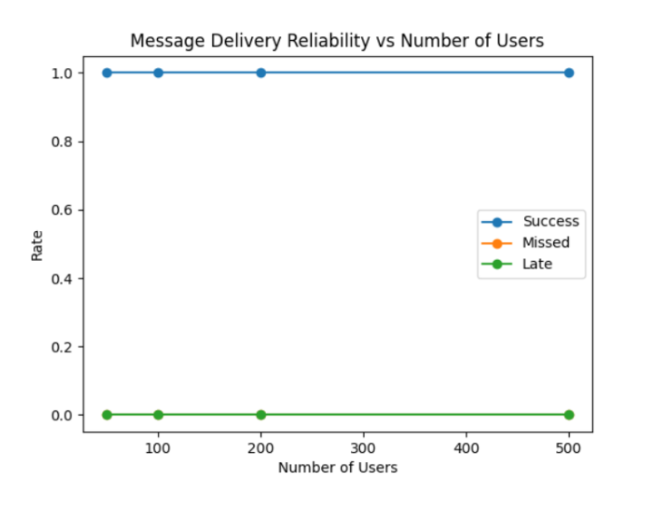
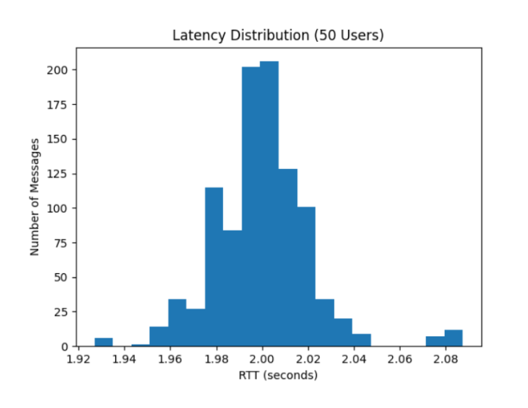
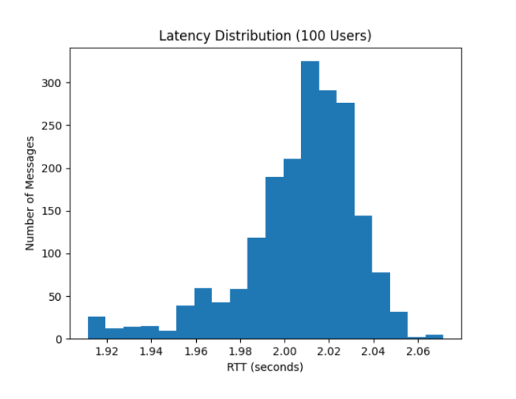
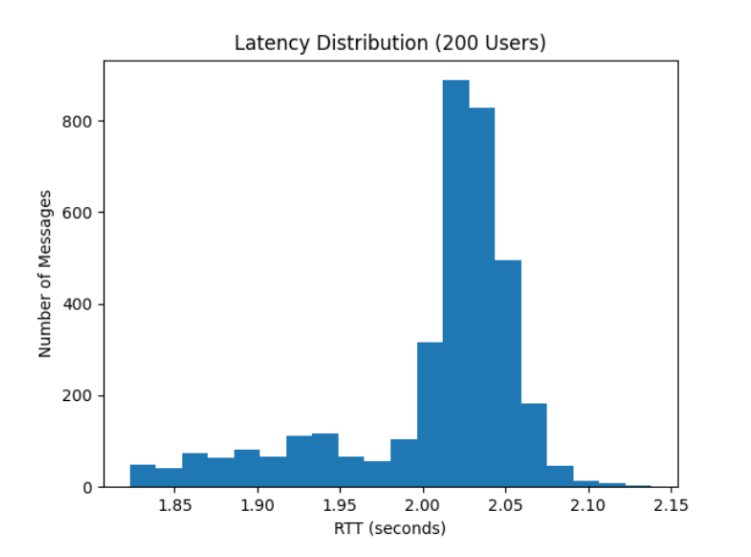
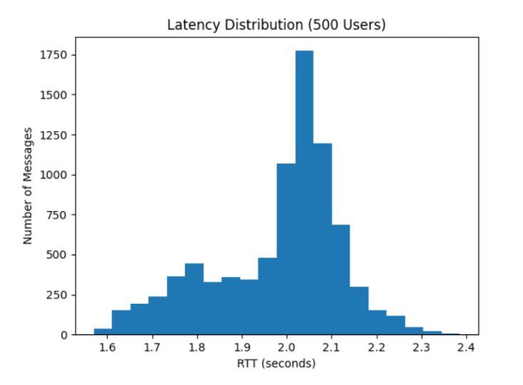

# CSE108C Vuvuzela Reimplementation
 
A Python reimplementation of **Vuvuzela**, a private messaging system that hides communication metadata (who is talking to whom, and whether anyone is talking at all) from a global network adversary. Built for CSE 108C.
 
Original paper: van den Hooff, Lazar, Zaharia, and Zeldovich. *Vuvuzela: Scalable private messaging resistant to traffic analysis.* SOSP '15, pp. 137-152.
 
> **Demo only.** This is a class project. All keys (in `keys.py`) and settings (in `config.py`) are hardcoded and committed for convenience. Do not use this code or these keys for real communication.
 
## Overview
 
Encrypting message contents isn't enough: traffic metadata can reveal relationships, routines, and behavior. In this system every client sends one fixed-size message per round, real or dummy, through a chain of three mix servers that decrypt, shuffle, and swap messages at dead drops.
 
**Threat model:** a global adversary that can observe network traffic, run traffic analysis over long periods, and compromise some (but not all) servers.
 
**Security goal:** prevent the adversary from learning who a user is talking to, or whether they are communicating at all.
 
**Crypto:** X25519 key exchange, HKDF key derivation, AES-GCM encryption, SHA-256 for dead drop IDs.
 
## Running It
 
1. Edit `config.py` to set the server IP, batching time, number of automatic clients, and number of server nodes.
2. Start the servers:
```bash
   python main.py
```
3. Start clients (on the same machine, other hosts, or VMs):
```bash
   python auto_client.py   # automatic clients that send cover traffic (number set in config)
   python client.py        # one interactive client in your terminal
```
 
Both client types can run at the same time.
 
**Client commands**
 
| Command | Action |
| --- | --- |
| `/new partner` | Shows your assigned username on first connect; afterward, pick a partner from the round's directory. |
| `/quit` | End the current conversation (then use `/new partner` to switch). |
 
Clients must already know their partner's assigned username (`client0`, `client1`, ...).
 
## Design Notes
 
- Servers are stationary (no server rotation) to keep the design simple.
- Clients and servers communicate over a real network layer using JSON control messages (`START_SEND`, `START_RECEIVE`, etc.).
- The server broadcasts the user directory and public keys at the start of every round and drops disconnected users.
- Clients log round number, send/receive times, round trip time, status, and decrypted message for each real message. These logs produced the latency results below.
## Protocol
 
**Joining.** The server assigns each new client an incrementing ID and username (`client` + ID), adds it to the directory, and sends the username back. Clients queue typed input so multiple messages can be sent across rounds without loss.
 
**Each round:**
 
1. The server broadcasts the directory, then sends `START_SEND` with the round number.
2. If the client has a partner, it derives a shared key (X25519 + HKDF) from its private key and the partner's public key.
3. The client builds a 256-byte payload. A real message is padded and encrypted with AES-GCM using the round number as nonce. If there's nothing to send, it encrypts 256 random bytes the same way, so dummy and real messages look identical.
4. A 16-byte dead drop ID is prepended: the first 16 bytes of `SHA-256(shared secret + round number)`. Both partners compute the same ID. With no partner, the ID is random.
5. The client onion-encrypts the payload, one layer per server (three), last server innermost. Each layer uses a fresh ephemeral X25519 key against that server's public key, HKDF, and AES-GCM, with the ephemeral public key and ciphertext length added as a header. The layer keys are saved to decrypt the response.
6. The server collects one message per client and broadcasts `START_RECEIVE`.
**Through the mixnet.** Each node peels its layer, shuffles the batch with a random permutation (saved temporarily), and forwards it. The last node swaps messages that share a dead drop ID; unmatched buckets get dummy messages. On the way back, each node unshuffles, re-encrypts with the saved key, deletes its temporary state, and passes the batch back. The first node returns each message to its client, and the next round starts.
 
**Receiving.** The client removes the onion layers with its saved keys, then decrypts with the shared partner key. Valid messages are displayed; anything else (dummies, or any message when there is no partner) is dropped.
 
## Experiments and Results
 
We ran 50, 100, 200, and 500 automated clients for 20 rounds each. The automated clients act as cover traffic: they run the same client framework and send messages through the mixnet every round. For each message we recorded round number, start time, received time, round trip time, and status (`success`, `missed`, or `late`). Raw logs are in the `log_<N>_users/` folders, and `graphing.py` makes the figures.
 

- **Figure 1:** average round trip time by user count.


- **Figure 2:** rate of successful, missed, and late messages.





- **Figures 3-6:** latency histograms per user count.
**Findings:** latency stayed between about 1 and 3 seconds even at 500 users, with only a slight increase from 50 to 500. Every message was delivered on time at every user count, with no missed rounds. Consistent timing regardless of whether a real message is being sent is what makes real and dummy traffic hard to tell apart.
 
## Limitations and Future Work
 
- **Directory scaling:** sending and parsing the full directory every round is the main bottleneck. The practical limit appears to be about 500 clients at a 2-second delay (batching time is configurable).
- **No dialing protocol:** clients must already know each other's usernames.
- **Cover traffic is simple:** automated clients just replicate the mixnet framework, and their traffic isn't varied.
- **Hardcoded keys:** for convenience, the long-term server and client keys are hardcoded in `keys.py` rather than generated. They are for demo use only and are not secure. A real deployment would generate keys, and servers would rotate theirs each round.
- **Fixed client-side node count:** encryption and the client support exactly 3 nodes.
- **No server rotation.**
- The client directory isn't reset when the server restarts.